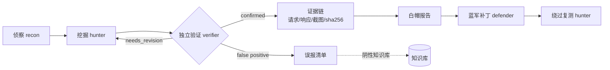

# Bounty Forge — AI 驱动的漏洞挖掘知识库与实战工具集

**EN** — A knowledge base + toolkit for AI multi-agent vulnerability research: methodology, lab-verified evidence, PoC scripts, nuclei templates and report templates. Local labs only.

> **免责声明**：本项目所有内容仅供安全学习与授权测试使用，禁止用于任何非法用途。使用前请确保已获得目标的明确书面授权。所有实战记录均基于本地靶场、虚拟机和容器环境，未对任何真实公网目标进行未授权测试。


AI 多 Agent 协作驱动的漏洞挖掘知识库——从侦察、检测、验证到报告，覆盖赏金猎手全流程。所有检测规则与结论均基于本地靶场实战验证，非破坏性检测优先。

本项目的目标是：**把 Web 众测赏金的完整流程（侦察 → 检测 → 验证 → 报告）练熟，先在本机靶场上做到可复现、可归档。**

---

## 项目亮点

### 🤖 AI 多 Agent 协作

- 多角色分工：侦察员、挖掘员、验证员、笔记员、靶场管理员、学习引导员
- 交叉验证：每个漏洞由独立验证员复现，排除误报
- 扁平编制：受子任务嵌套深度限制，不搞多层指挥，队长直接对接成员
- 车道切换：优先走免费额度车道，额度耗尽再切备用车道（不追求零成本，追求可复现）

### 🔬 实战验证

- 每条结论都有本地靶场实测证据，非纸上谈兵
- 证据四段齐全：变更前 → 攻击请求 → 变更后 → 复原后
- 每份证据计算 sha256，可追溯可验证
- 阴性结果同样留证，不隐瞒失败

### 🛡️ 非破坏性优先

- 检测脚本只做 GET/HEAD 探测，不做利用
- Nuclei 模板只做指纹识别和确认，不执行破坏性操作
- 写操作必须可回滚，验证后立即复原
- 严格遵守授权范围，只打 127.0.0.1 / 本地 VM / 容器

### 📝 去 AI 味报告

- 漏洞盒子提交模板 + 实战范文
- 笔记式写作，不用"可能"、"也许"、"理论上可以"
- 标题公式：`[漏洞类型] in [端点] allows [角色] to [影响]`
- CVSS 3.1 速查 + 降级反驳话术 + 60 秒提交前检查清单

### 💡 原创方法论

- 7 问验证门：一个答错就杀掉，不写报告
- 永不提交黑名单：30+ 种「稳定判为 N/A」的漏洞类型
- 漏洞链方法论：A→B→C 集群狩猎，单漏洞给钱少，链给 3-10 倍
- 顶级黑客思维框架：皇冠珠宝思维、开发者共情、信任边界映射
- 判据可靠性速查表：哪些信号可信，哪些是假 oracle

---

## 目录结构

```
bounty-forge/
├── README.md                          # 本文件：项目介绍与快速索引
├── LICENSE                            # MIT 许可证
├── .gitignore                         # Git 忽略规则
├── CHANGELOG.md                       # 版本变更记录
├── CONTRIBUTING.md                    # 贡献指南（含合作者申请方式）
├── SECURITY.md                        # 漏洞报告与安全边界
├── INDEX.md                           # 详细归档索引（所有证据文件清单）
├── EVIDENCE_METHODOLOGY_MAP.md        # ⭐ 证据链↔方法论对应关系（每条漏洞关联哪条教训）
│
├── .github/                           # CI（相对链接体检 + 凭据扫描）与 Issue 模板
├── docs/                              # 导航与发布说明
│   ├── NAVIGATION.md                  # 长索引的入口页
│   ├── PUBLISHING.md                  # 公开/私有内容边界清单
│   └── ENVIRONMENT.md                 # 环境、依赖安装链接、国内网络实测
│
├── cve-lib/                           # CVE 知识库
│   ├── CVE靶场清单.md                  # 实读 182 个 Vulhub 环境，命中入库 64 条
│   └── loop4-执行顺序.md              # 64 条 CVE 序列（P0=2 / P1=26 / P2=36）的执行优先级
│
├── playbook/                          # 方法论与避坑手册
│   ├── 挖洞避坑手册.md                  # 13 条原创教训 + 判据可靠性速查表
│   ├── 7问验证门与永不提交黑名单.md      # ⭐ 验证方法论
│   ├── 漏洞链方法论-A到B到C集群狩猎.md   # ⭐ 链化思维
│   ├── 顶级黑客思维框架.md               # ⭐ 心智模型
│   └── 工具清单与OSINT资源.md            # ⭐ 工具与搜索引擎
│
├── nuclei-rules/                      # Nuclei 模板（5 个 + 1 份资产索引）
│   ├── B1-DVWA-LFI-PATH-TRAVERSAL.yaml
│   ├── B4-DVWA-SESSION-FIXATION-WEAK-ID.yaml
│   ├── C1-SHIRO-FINGERPRINT.yaml
│   ├── C2-TOMCAT-2017-12615-PUT-CONFIRM.yaml
│   ├── DVWA-SESSION-COOKIE-ATTRIBUTES.yaml
│   └── _ASSET-INDEX.md
│
├── poc/                               # Python 非破坏性检测脚本（4 个脚本 + 1 个网络库）
│   ├── bfnet.py                       # 网络工具库（物理上只接 GET/HEAD，传 PUT 直接抛错）
│   ├── bf_b1_dvwa_lfi.py              # DVWA LFI 检测
│   ├── bf_b4_dvwa_session_fixation.py # DVWA 会话固定检测
│   ├── bf_c1_shiro_fingerprint.py     # Shiro 指纹检测
│   ├── bf_c2_tomcat_put_readonly.py   # Tomcat PUT 只读确认
│   └── README.md
│
├── reports/                           # 报告模板与实战报告
│   ├── submit/                        # 提交版模板
│   │   ├── 漏洞盒子报告模板-提交版.md
│   │   ├── 报告写作增强指南.md           # ⭐ 标题公式+CVSS+反驳话术
│   │   ├── 提交前自查清单.md
│   │   ├── 示例-参考报告-C1-Shiro.md
│   │   └── _selfcheck-template.ps1
│   ├── a-档/                          # A 档：加固版验证报告
│   ├── b-档/                          # B 档：DVWA/bWAPP 漏洞报告
│   ├── c-档/                          # C 档：Vulhub CVE 复现报告
│   ├── t5-target-site-lab/            # target-site-lab 靶场漏洞报告
│   ├── meta-总账/                      # 进度、能力矩阵、学习路径
│   └── archive/                       # 归档模板
│
├── evidence/                          # 实战证据（按轮次分类）
│   ├── A/                             # A 档证据
│   ├── B/                             # B 档证据
│   ├── C/                             # C 档证据
│   ├── L2/                            # loop2 沙箱对照证据
│   ├── T5/                            # t5 团队挖掘证据
│   ├── META/                          # 元数据与统计
│   └── UNSORTED/                      # 待整理证据
└── （共 483 个文件：证据 213 / 报告 43 / 模板 18 / 其余为文档与脚本）
```

---

## 核心内容

### 零、证据链 ↔ 方法论对应（⭐ 新手必读）

| 文档 | 内容 | 亮点 |
|---|---|---|
| [证据链↔方法论对应关系](EVIDENCE_METHODOLOGY_MAP.md) | 每条已验证漏洞的证据链 ↔ 对应教训 ↔ 判据可靠性 | C1 Shiro 四重证据拆解、B3 CSRF 差分对照、判据可靠性速查表 |

> **为什么先读这个**：13 条教训散落在避坑手册里，对应关系把它们和具体漏洞绑在一起。下次遇到同类洞，直接知道该用哪条判据、避开哪个坑。

### 一、方法论（playbook/）

| 文档 | 内容 | 亮点 |
|---|---|---|
| [挖洞避坑手册](playbook/挖洞避坑手册.md) | 13 条原创挖洞教训 + 判据可靠性速查表 | Shiro 假 oracle、Runtime.exec() 异步、队长方案必须受控对照 |
| [7问验证门与永不提交黑名单](playbook/7问验证门与永不提交黑名单.md) | 7 问验证 + 4 道提交关卡 + 30+ 永不提交类型 + 常见 N/A 杀掉信号 | 一个答错就杀掉，不浪费时间写 N/A 报告 |
| [漏洞链方法论](playbook/漏洞链方法论-A到B到C集群狩猎.md) | A→B→C 链对照表 + 6 步集群狩猎协议 + 真实案例 | 单漏洞给钱少，链给 3-10 倍 |
| [顶级黑客思维框架](playbook/顶级黑客思维框架.md) | 4 步心智框架 + 7 条顶级规则 + 思维陷阱 | 皇冠珠宝思维、开发者共情、信任边界映射 |
| [工具清单与OSINT资源](playbook/工具清单与OSINT资源.md) | 18+ 已装工具 + 10 类 OSINT 搜索引擎 + 侦察标准流程 | Shodan/Censys/FOFA/crt.sh 等 |

### 二、CVE 知识库（cve-lib/）

- **64 条 CVE 靶场清单**：逐个实读 182 个 Vulhub 环境目录（compose / Dockerfile / README），命中入库 64 条，覆盖 Shiro、Tomcat、Struts2、Fastjson、Log4j、Weblogic、ThinkPHP、WordPress 等
- **执行优先级排序**：按赏金高频度与利用价值排序（P0=2 / P1=26 / P2=36），并附「只绑回环、只读验证」等执行铁律
- **已复现 CVE**（完整报告在 `reports/c-档/`）：
  - CVE-2016-4437：Shiro rememberMe 反序列化 RCE（默认密钥，3 条 gadget 链）
  - CVE-2017-12615：Tomcat PUT 上传 RCE
  - 复现过程与判据复盘：c-档 3 份报告（C1 判据复盘 / T7 复现 / 三段式对照）+ `evidence/C/` 下 72 个取证脚本与日志
  - 其余 CVE 按 `cve-lib/loop4-执行顺序.md` 的 64 条序列排期推进（本仓库只发布已验证的部分，未验证的不会写进来）

### 三、检测工具（detection/）

#### Nuclei 模板（5 个）

| 模板 | 检测目标 | 类型 |
|---|---|---|
| C1-SHIRO-FINGERPRINT | Shiro 默认密钥指纹 | 指纹识别 |
| C2-TOMCAT-2017-12615-PUT-CONFIRM | Tomcat PUT 方法确认 | 非破坏性确认 |
| B1-DVWA-LFI-PATH-TRAVERSAL | DVWA LFI 路径穿越 | 漏洞检测 |
| B4-DVWA-SESSION-FIXATION-WEAK-ID | DVWA 弱会话 ID | 漏洞检测 |
| DVWA-SESSION-COOKIE-ATTRIBUTES | DVWA Cookie 属性检查 | 配置检测 |

#### Python 检测脚本（4 个脚本 + 1 个网络库）

所有脚本只做 GET/HEAD 探测，不执行利用。bfnet.py 网络库物理上只接 GET/HEAD，传 PUT 直接抛 ValueError。
脚本自带目标白名单（只允许 `127.0.0.1` / `localhost` / `192.168.56.x`），传公网地址会直接退出。

| 脚本 | 检测目标 |
|---|---|
| bf_b1_dvwa_lfi.py | DVWA LFI 路径穿越（6 级深度检测） |
| bf_b4_dvwa_session_fixation.py | DVWA 会话固定与弱会话 ID |
| bf_c1_shiro_fingerprint.py | Shiro 默认密钥指纹 |
| bf_c2_tomcat_put_readonly.py | Tomcat PUT 方法只读确认 |

### 四、报告模板（reports/submit/）

- **漏洞盒子报告模板-提交版**：纯文本提交模板 + 归档版七节模板 + 16 类漏洞证据清单
- **报告写作增强指南**：标题公式 + CVSS 3.1 速查 + 降级反驳话术 + 60 秒检查清单
- **提交前自查清单**：提交前逐项检查
- **示例-参考报告-C1-Shiro**：Shiro RCE 完整实战报告范文

### 五、实战报告（43 份，含模板与总账）

#### A 档：target-site-lab 加固版验证

- 12 项加固判定 + 6 条残余需处理 + 14 条阴性 + 0 误报
- 发现残余绕过：跨站 Origin/Referer 仍能触发复位

#### B 档：DVWA / bWAPP

| 编号 | 漏洞 | 等级 | 关键证据 |
|---|---|---|---|
| B1 | LFI 路径穿越 | 中 | 6 级深度检出 root:x:0:0 |
| B2 | XXE | 低 | PHP 8.4 默认不展开外部实体（阴性留证） |
| B3 | CSRF | 中 | 真实差分对照，bee.secret 变更已复原 |
| B4 | 会话固定 | 中 | dvwaSession 可预测，use_strict_mode=Off |
| B5 | 存储 XSS | 高 | 完整链：Chromium 执行→接收端收到 PHPSESSID→接管会话 |

#### C 档：Vulhub CVE 复现

| 编号 | 漏洞 | CVE | 等级 | 关键证据 |
|---|---|---|---|---|
| C1 | Shiro 反序列化 RCE | CVE-2016-4437 | 严重 | 默认密钥 + 3 条 gadget 链 + OOB 外带 + /proc 实测 |
| C2 | Tomcat PUT RCE | CVE-2017-12615 | 高危 | PUT /shell.jsp/ → 201 → 回显 uid=0(root) |

#### t5：target-site-lab 团队挖掘

- 15+ 条验证漏洞，覆盖业务逻辑、认证绕过、SSRF、文件上传等
- VULN-03：SECRET_KEY 泄露 → CSRF 令牌伪造 → 转账成功（完整攻击链）

---

## 三条最值钱的原创教训

### 教训 1：Shiro 假 oracle — rememberMe=deleteMe 不能判反序列化成败

只要 rememberMe cookie 非空，无论内容如何、请求哪个路径，服务端都回 deleteMe=true（包括 /login anon 路径）。正确的验证方式是**外带 oracle（HTTP OOB）+ 容器 /proc 进程证据 + 日志行号锚点**。

### 教训 2：Runtime.exec() 异步 — sleep N 计时不能判 RCE

Java Runtime.exec() 是异步的，sleep 命令的执行时间不会反映在 HTTP 响应延迟中。最初用 sleep 计时误判 C1 失败，后靠 OOB 回调 + /proc 实测 sleep 进程推翻。

### 教训 3：任何人的技术方案（包括队长的）都必须先做受控对照

队长本轮错了三次，被成员顶回两次，零次自查出来。核心规则：**没有对照就没有发言权。** 拿"有 deleteMe"当失败、拿"没 BadPaddingException"当成功——都是拿缺失的信号推断正面事实。

---

## 快速开始

### 1. 克隆项目

```bash
git clone https://github.com/xunwmw/bounty-forge.git
cd bounty-forge
```

> 国内直连 `github.com` 可能握手超时（2026-10-16 实测），`codeload.github.com` 的「Download ZIP」也常不通。
> 绕法（含 **WARP 官方下载路径**）见 [docs/ENVIRONMENT.md](docs/ENVIRONMENT.md)。

### 2. 阅读方法论

建议按以下顺序阅读：

1. **[7问验证门与永不提交黑名单](playbook/7问验证门与永不提交黑名单.md)** — 先知道什么洞不该报
2. **[挖洞避坑手册](playbook/挖洞避坑手册.md)** — 13 条原创教训
3. **[顶级黑客思维框架](playbook/顶级黑客思维框架.md)** — 建立正确的狩猎心智
4. **[漏洞链方法论](playbook/漏洞链方法论-A到B到C集群狩猎.md)** — 学会链化思维
5. **[工具清单与OSINT资源](playbook/工具清单与OSINT资源.md)** — 工具与搜索引擎参考

### 3. 使用检测模板

```bash
# Nuclei 模板
nuclei -u http://127.0.0.1:8080 -t nuclei-rules/

# Python 检测脚本
cd poc
python bf_c1_shiro_fingerprint.py -u http://127.0.0.1:8080
```

> 上面两处目标都写成 `127.0.0.1` 不是偷懒：脚本与模板都按「只打本机靶场」设计，换成公网地址会被 `bfnet` 的白名单直接拒绝。

### 4. 使用报告模板

复制 `reports/submit/漏洞盒子报告模板-提交版.md`，按模板填写。提交前用 `提交前自查清单.md` 逐项检查。

---

## 技术栈与环境

**最快路径**：本仓库主体是 Markdown 知识库 + 几个纯标准库 Python 脚本，**不装任何依赖也能读、能跑**。
详细的系统版本要求、各工具官方安装链接、中国大陆网络实测与 WARP 使用说明，都在这份文档里 → [docs/ENVIRONMENT.md](docs/ENVIRONMENT.md)

### 硬件

- CPU：E3-1271 v3
- 内存：16 GB DDR3（跑多容器靶场时建议升到 32 GB）
- GPU：GTX 650（跑 AI 用不上，判定走 API）

### 软件

- DSH（DeepSeek Harness）：AI 多 Agent 协作平台
- 车道与模型：优先用免费额度车道（DeepSeek V4.1 Flash、GLM 5.3 Flash 等），额度耗尽再切备用车道
- Kali Linux（VirtualBox VM）：渗透测试环境
- Docker：Vulhub 漏洞环境
- 工具链：nmap、nuclei、httpx、katana、ffuf、sqlmap 等 18+ 工具

### 靶场

- target-site-lab（8095 / 8091）：自研靶场，Python 标准库，只绑 `127.0.0.1`
- DVWA / bWAPP：经典 Web 漏洞靶场（Docker 或 Kali VM 均可）
- Vulhub（Docker）：64 条入库 CVE 环境，按序列逐个复现

---

## 路线图

### D0-D2：基础积累（已完成）

- ✅ 自研靶场搭建与加固验证
- ✅ DVWA/bWAPP 经典漏洞复现
- ✅ Vulhub CVE 复现（Shiro/Tomcat）
- ✅ 方法论沉淀（13 条教训 + 验证门 + 链化思维）
- ✅ 检测工具开发（Nuclei 模板 + Python 脚本）
- ✅ 报告模板优化

### D3-D4：能力扩展（进行中）

- 🔄 Fastjson / Log4j2 实弹复现（赏金高频洞）
- 🔄 检测框架升级（三段式 + Shiro 多链密钥爆破）
- 🔄 知识库升级（原理深度分析 + 利用链图谱 + 修复对比）
- 🔄 3 篇去 AI 味报告范文

### D5-D6：赏金实战（规划中）

- ⏳ 内网域渗透（需升级内存到 32GB）
- ⏳ 漏洞盒子真实项目测试（先把授权靶场与自建环境的流程跑顺）
- ⏳ 自动化挖掘流水线

---

## 贡献指南

欢迎贡献！最有价值的贡献：

1. **新的检测模板或检测技术**
2. **Payload 补充**（到 nuclei-rules/）
3. **方法论改进**（有实战报告支撑的）
4. **新的 CVE 复现报告**（带完整证据）
5. **平台支持**（补天、CNVD 等报告模板）

想直接一起维护这个仓库（而不只是提 PR），可以走 [合作者申请](https://github.com/xunwmw/bounty-forge/issues/new?template=collaborator_request.md)，见文末「反馈 · 合作」。

### 贡献流程

```bash
git checkout -b feature/your-contribution
git commit -m "feat: 简短描述"
git push origin feature/your-contribution
# 提交 Pull Request
```

---

## 致谢

本项目参考了以下优秀开源项目：

- [Agentic-Bug-Hunter](https://github.com/Awarexone/Agentic-Bug-Hunter) — AI 赏金工具，7 问验证门、漏洞链方法论、报告写作模板的来源
- [nahamsec/Resources-for-Beginner-Bug-Bounty-Hunters](https://github.com/nahamsec/Resources-for-Beginner-Bug-Bounty-Hunters) — 赏金入门资源大全
- [ffffffff0x/1earn](https://github.com/ffffffff0x/1earn) — 中文安全知识框架
- [Threekiii/Awesome-Redteam](https://github.com/Threekiii/Awesome-Redteam) — 中文攻防知识库
- [xiaoy-sec/Pentest_Note](https://github.com/xiaoy-sec/Pentest_Note) — 渗透测试笔记
- [OWASP/wstg](https://github.com/OWASP/wstg) — Web 安全测试指南
- [Vulhub](https://github.com/vulhub/vulhub) — 155 个漏洞环境
- [ProjectDiscovery](https://github.com/projectdiscovery) — nuclei/httpx/katana/subfinder 等工具

---

## 许可证

[MIT License](LICENSE)

---

> **最后提醒**：安全是一把双刃剑。本项目的所有内容都是为了帮助你理解漏洞原理、提升防御能力。请始终在授权范围内进行测试，不要用学到的知识做任何违法的事情。

---

## 从这里开始

- 想快速了解：往下读本 README 的「项目亮点」与「核心内容」
- 想按主题跳转：[docs/NAVIGATION.md](docs/NAVIGATION.md)（130KB 索引的入口页）
- 想贡献或发布：[docs/PUBLISHING.md](docs/PUBLISHING.md)（公开/私有边界清单）
- 想先跑起来：[docs/ENVIRONMENT.md](docs/ENVIRONMENT.md)（系统要求 / 安装链接 / 国内网络与 WARP）


---

## 工作流（证据链）



> 项目里所有结论都走这条链：**没有独立复现的结论不算 confirmed**，误报与阴性同样留档。

---

## 反馈 · 合作

> 如果你在使用时发现了任何问题，可以给我发消息或者私信我。不过最好不要私信，本人社恐。欢迎大佬给我的项目提意见。
> 如果你使用时发生了错误或者没法使用，也可以修改我的项目。申请项目合作人。

| 你想做的事 | 点哪里 |
| --- | --- |
| 跑不起来 / 有报错 | [提 Bug 报告](https://github.com/xunwmw/bounty-forge/issues/new?template=bug_report.md) |
| 想要新内容 / 提意见 | [提功能建议](https://github.com/xunwmw/bounty-forge/issues/new?template=feature_request.md) |
| **想一起做这个项目（申请项目合作人）** | [提交合作者申请](https://github.com/xunwmw/bounty-forge/issues/new?template=collaborator_request.md) |
| 已经改好了 | 直接发 Pull Request（约定见 [CONTRIBUTING.md](CONTRIBUTING.md)） |

「申请项目合作人」就是 GitHub 的仓库协作者（Collaborator）：你提申请，我会在 **Settings → Collaborators** 里把你加进来，
通过后你有这个仓库的写权限（能建分支、提 PR、管 Issue），比一直 fork 省事。
